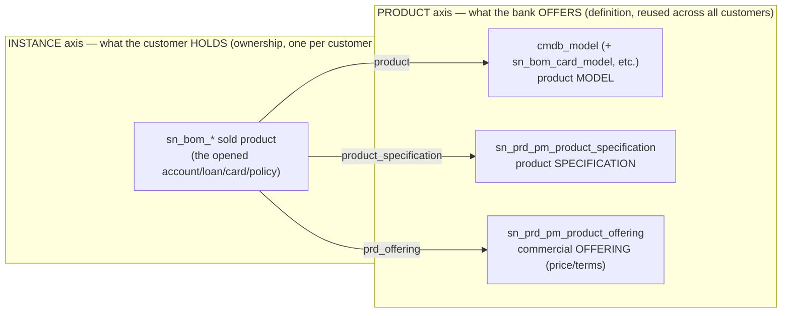
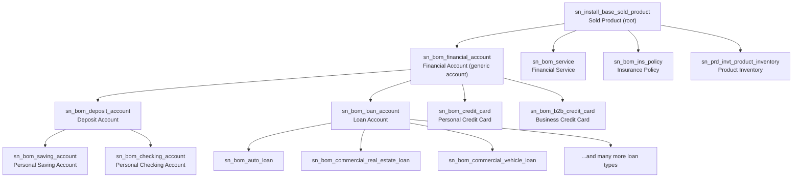
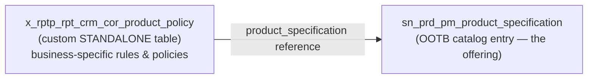

# CRMCore
Standardized Datamodel for CRM journey ( Lead and Onboarding ) built on Servicenow Platform with FSO / CSM dependency 


# RPT CRM Core — Financial Product Data Model (v2)

> **Status:** Conceptual / discussion artifact. **No code is built from this yet.**
> This document supersedes the earlier "Retail Account Onboarding" draft (v1). It records our
> *stabilized shared understanding* of the generic, reusable financial-product data model that
> RPT CRM Core will be built on. All table lineage below was **verified against this instance**.
>
> **Scope:** `x_rptp_rpt_crm_cor`

---

## 1. Purpose & ambition

RPT CRM Core is a **generic, reusable data model** for a Financial CRM. The goal is *not* a single
onboarding app, but a foundation where **any** banking or financial product offering — savings,
current, retail/commercial loans, cards, insurance, services — can be slotted under the **correct
out-of-box (OOTB) parent class**, and extended with **business-specific** structures where the
platform has no native provision.

Two guiding principles:

1. **Reuse OOTB lineage.** Prefer extending the ServiceNow FSO/BOM + Install Base classes so we
   inherit the banking fields (balance, interest, principal, premium, etc.) rather than rebuilding them.
2. **Custom only where it cannot be standardized.** Add custom tables only for genuinely
   business-specific concepts (e.g. product-level policies/rules) that OOTB cannot express cleanly.

---

## 2. The two axes (core mental model)

The single most important concept. There are **two independent axes**, joined by **reference, not
inheritance**:



- **PRODUCT axis** = the catalog/definition. One record per offering, reused by every customer.
- **INSTANCE axis** = the sold product. One record per customer per account/loan/card.
- They connect via three **verified** reference fields on the sold product (see §5).

---

## 3. Catalog — table of record (DECISION)

**Decision:** the catalog's source of truth is **`sn_prd_pm_product_specification`**.

- This is the table the OOTB `sold_product.product_specification` field already references, so every
  sold product and our custom structures align on **one consistent anchor** — minimal custom glue.
- The earlier draft's **`sn_prd_pm_service_specification`** is **SUPERSEDED** for this purpose.

Supporting Product Management (`sn_prd_pm_*`) building blocks available OOTB:

| Table | Role |
|---|---|
| `sn_prd_pm_product_specification` | The catalog entry (the offering definition) — **our anchor** |
| `sn_prd_pm_product_offering` | Commercial wrapper: pricing, terms, channels (makes a spec sellable) |
| `sn_prd_pm_specification_relationship` | Parent → child (product → sub-product) links |
| `sn_prd_pm_catalog_category` + category relationships | Taxonomy (e.g. Deposits → Savings/Current; Lending → Retail/Commercial) |
| `sn_prd_pm_characteristic` + options | Simple, data-driven configurable attributes on a spec |

The catalog is **data-driven**: offerings are authored as *records* in Product Management (PLM
workspace / import), not as new tables.

---

## 4. Sold Product parent menu (INSTANCE axis) — VERIFIED lineage

Everything a customer *holds* descends from the root `sn_install_base_sold_product`. Verified tree:



### How to choose the correct parent

| If the product is a… | Extend… | You inherit… |
|---|---|---|
| Savings / term deposit | `sn_bom_saving_account` (or `sn_bom_deposit_account`) | balance, interest rate, statement frequency, account number |
| Current / checking | `sn_bom_checking_account` | deposit fields + overdraft/debit behavior |
| Any loan (retail or commercial) | `sn_bom_loan_account` | principal, APR, moratorium, installments, delinquency, risk rating |
| Credit card | `sn_bom_credit_card` / `sn_bom_b2b_credit_card` | credit limit, APR cash/card, billing cycle |
| Insurance | `sn_bom_ins_policy` | premium, policy number, effective/expiry |
| Pure service (no account mechanics) | `sn_bom_service` | SLA / service-level fields |
| A new account-like product that fits none of the above | `sn_bom_financial_account` | generic account spine (balance, consumer, account number, open/close) |
| Something with no account semantics at all | `sn_install_base_sold_product` | the bare sold-product spine |

> **Rule of thumb:** extend the *lowest* class that already carries the fields you need. Add only the
> few app-specific fields on top. Reserve a brand-new custom subclass for genuinely novel products.

---

## 5. How instance links to definition — VERIFIED reference fields

The sold product (and therefore any `x_*` subclass of it) carries **three** catalog links:

| Field on sold product | References | Meaning |
|---|---|---|
| `product` | `cmdb_model` | The product *model* (NB: `cmdb_model` is referenced, **not** a parent class) |
| `product_specification` | `sn_prd_pm_product_specification` | The catalog *specification* — **our anchor** |
| `prd_offering` | `sn_prd_pm_product_offering` | The commercial *offering* (pricing/terms) |

> Clarification settled during discussion: `sn_install_base_sold_product` is a **root table** (no
> `super_class`). It is **not** derived from `cmdb_model`. `cmdb_model` is a separate hierarchy that
> the sold product merely *references* via the `product` field.

---

## 6. Product-level business rules & policies (DECISION)

**Requirement:** hold configurable **business rules and policies at the product level** — something
OOTB tables do not provide for.

**Decision:** model this as a **standalone custom table** on the **PRODUCT axis** that **references**
the specification — **not** by extending `sn_prd_pm_product_specification`.



**Why standalone (reference) instead of extension:**

- **Bespoke, non-standardizable attributes.** The columns are highly client-specific and should not
  pollute or couple to the shared OOTB spec structure.
- **One-to-many.** A single offering can carry *many* policy/rule records (effective-dated,
  prioritized, conditional) — impossible with a single extended row.
- **No inheritance coupling.** The custom table owns 100% of its columns; nothing leaks into the
  OOTB catalog, and clients can diverge freely.
- **Stable join.** The `product_specification` reference is the consistent anchor back to the product
  axis — the same spec the sold product already points at.

*(Table/field names above are illustrative placeholders; final naming to be decided at build time.)*

---

## 7. When to create custom classes — summary

| Need | Axis | Approach |
|---|---|---|
| Extra fields on the thing a customer holds | INSTANCE | Custom subclass of the nearest `sn_bom_*` sold-product class |
| Simple configurable attributes on an offering | PRODUCT | OOTB `sn_prd_pm_characteristic` + options (no new table) |
| Product-level business rules / policies | PRODUCT | **Standalone custom table referencing `sn_prd_pm_product_specification`** |

---

## 8. Open items (to resolve before build)

- [ ] Confirm the exact set of **product families** to model first (deposits only, or deposits +
      lending + cards + insurance from the start).
- [ ] Decide whether RPT CRM Core includes an **onboarding/case layer** now, or stays purely a data
      model (the v1 draft's case layer is parked pending this decision).
- [ ] Define the concrete **columns** for the custom product-policy table (client-specific).
- [ ] Verify required **plugins/scopes** (FSO/BOM, CSM, Install Base, Product Management) are active
      and that we may extend their tables from our scope.
- [ ] Finalize **naming conventions** for custom subclasses and the product-policy table.

---

## 9. Quick reference — what extends what

```
INSTANCE axis (customer holdings)
sn_install_base_sold_product            (root)
├─ sn_bom_financial_account             (generic account)
│  ├─ sn_bom_deposit_account
│  │  ├─ sn_bom_saving_account          ← savings products
│  │  └─ sn_bom_checking_account        ← current/checking products
│  ├─ sn_bom_loan_account               ← all loans (retail + commercial)
│  ├─ sn_bom_credit_card
│  └─ sn_bom_b2b_credit_card
├─ sn_bom_service                       ← pure services
├─ sn_bom_ins_policy                    ← insurance
└─ sn_prd_invt_product_inventory

PRODUCT axis (catalog / definition)
sn_prd_pm_product_specification          ← catalog anchor (DECISION)
sn_prd_pm_product_offering               ← commercial offering
sn_prd_pm_specification_relationship     ← product → sub-product
x_rptp_rpt_crm_cor_product_policy        ← CUSTOM, references the specification

Links: sold_product.product → cmdb_model
       sold_product.product_specification → sn_prd_pm_product_specification
       sold_product.prd_offering → sn_prd_pm_product_offering
```

